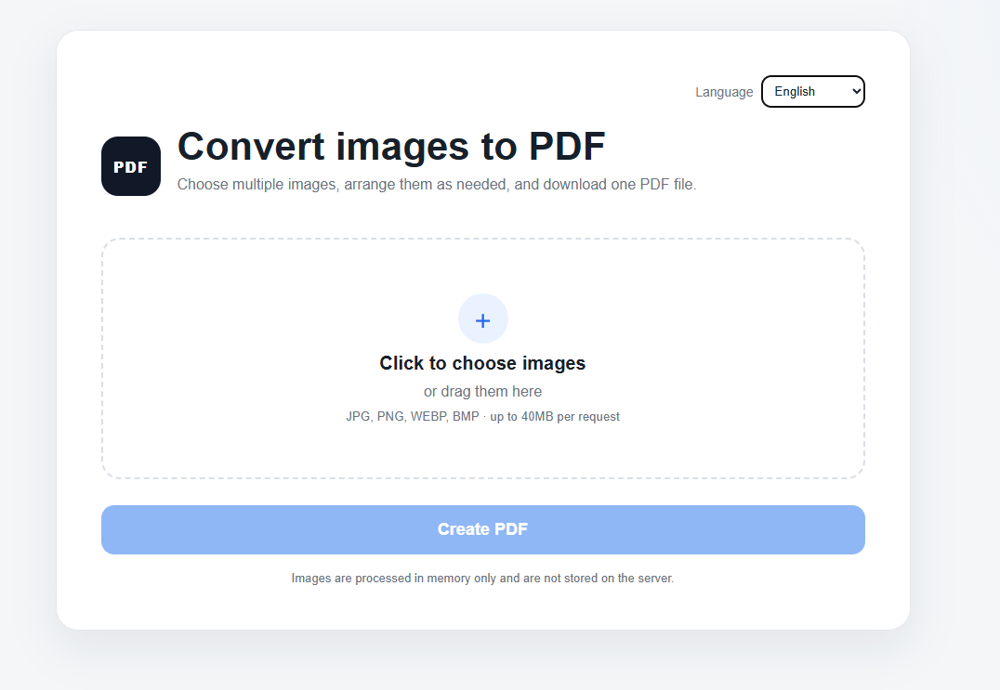
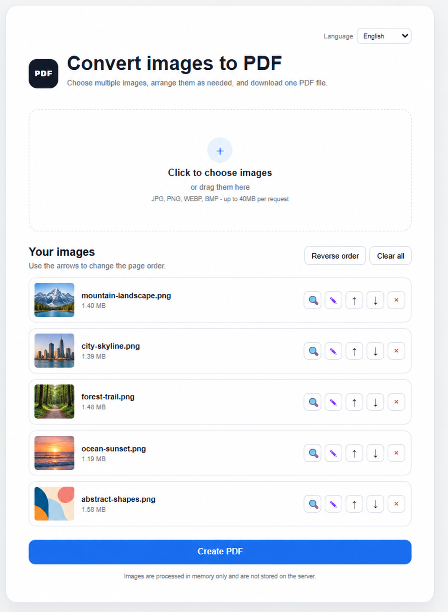
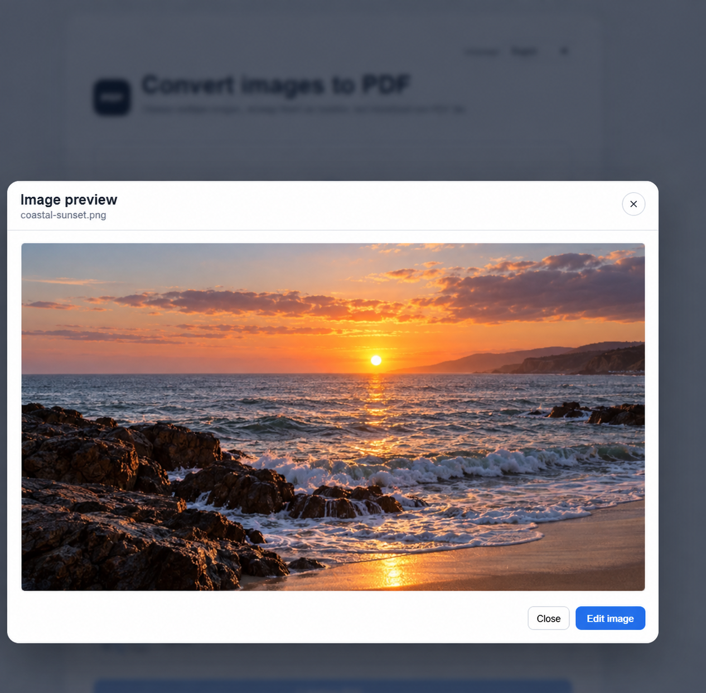

# Image2PDF

[English](README.md) | **עברית**

Image2PDF היא אפליקציית Flask קלת משקל להעלאה, סידור, עריכה והמרה של
מספר תמונות לקובץ PDF אחד. ניתן להריץ אותה כשירות אינטרנט, בתוך Docker או
כקובץ הרצה שולחני עצמאי.

הממשק זמין באנגלית ובעברית ועובר אוטומטית בין תצוגה משמאל לימין לתצוגה
מימין לשמאל.

## צילומי מסך

### העלאה וסידור עמודים

| מסך העלאה | רשימת התמונות וכלי סידור העמודים |
| --- | --- |
|  |  |

### תצוגה ועריכה

| תצוגה מוגדלת | עורך התמונות |
| --- | --- |
|  |  |

## יכולות

- העלאת מספר תמונות באמצעות בוחר הקבצים או גרירה ושחרור.
- תמיכה בקובצי JPG, JPEG, PNG, WEBP ו־BMP.
- תצוגה מקדימה של כל תמונה לפני יצירת ה־PDF.
- שינוי סדר העמודים באמצעות החצים או היפוך מלא של הסדר.
- הסרת תמונות בודדות או ניקוי הרשימה כולה.
- תצוגה מעט מוגדלת לצד כפתור ההגדלה בעת מעבר עם העכבר.
- פתיחת תמונה בחלון תצוגה מוגדל.
- מעבר ישיר מחלון התצוגה למצב עריכה.
- שינוי בהירות, ניגודיות, רוויה וגוון.
- המרת תמונה לשחור־לבן.
- רוטציה באמצעות סרגל מעלות או כפתורי קיצור של 90 מעלות.
- סימון וחיתוך אזור ישירות מתוך התמונה.
- שמירת התמונה הערוכה בחזרה לרשימת ההעלאה לפני יצירת ה־PDF.
- בורר שפה עברית/אנגלית השומר את הבחירה בדפדפן.
- הודעות אימות מתורגמות מצד השרת.
- עיבוד התמונות וה־PDF בזיכרון בלבד, ללא שמירת הקבצים בשרת.
- מגבלת בקשה כוללת של 40MB.
- בניית קובצי הרצה עבור Windows, macOS ו־Linux.
- תמיכה ב־Docker לפריסה כשירות אינטרנט.

## הורדת קובצי הרצה מוכנים

כל תגית גרסה יוצרת GitHub Release הכולל הורדות ישירות לכל מערכות ההפעלה
השולחניות הנתמכות:

- [הורדה עבור Windows](../../releases/latest/download/Image2PDF-Windows.exe)
- [הורדה עבור macOS](../../releases/latest/download/Image2PDF-macOS)
- [הורדה עבור Linux](../../releases/latest/download/Image2PDF-Linux)

לכל קובץ הרצה מצורף checksum מסוג `.sha256` ודוח רישיונות צד־שלישי המתאים
למערכת ההפעלה. ניתן למצוא אותם ב[עמוד הגרסה האחרונה](../../releases/latest).

קובצי ההרצה אינם חתומים כרגע. Windows SmartScreen ו־macOS Gatekeeper עשויים
להציג אזהרה עד שיוגדר code signing מתאים. ב־macOS וב־Linux יש להעניק לקובץ
הרשאת הרצה לפני הפעלתו:

```bash
chmod +x Image2PDF-macOS   # macOS
chmod +x Image2PDF-Linux   # Linux
```

## דרישות מערכת

- מומלץ להשתמש ב־Python 3.10 ומעלה.
- דפדפן מודרני התומך ב־Canvas וב־`DataTransfer`.

התקנת תלויות האפליקציה:

```bash
python -m pip install -r requirements.txt
```

## הרצה מקומית

### Windows PowerShell

```powershell
py -m venv .venv
.\.venv\Scripts\Activate.ps1
python -m pip install -r requirements.txt
python app.py
```

### macOS ו־Linux

```bash
python3 -m venv .venv
source .venv/bin/activate
python -m pip install -r requirements.txt
python app.py
```

לאחר ההפעלה יש לפתוח:

```text
http://localhost:5000
```

שרת הפיתוח מאזין כברירת מחדל ב־`127.0.0.1`. משתני הסביבה האופציונליים הם
`HOST`, `PORT` ו־`FLASK_DEBUG`. אין לחשוף את שרת הפיתוח של Flask ישירות
בסביבת Production.

## הרצה באמצעות uv

```bash
uv venv
uv pip install -r requirements.txt
uv run python app.py
```

## יצירת קובץ הרצה מקומי

תחילה יש להתקין את תלויות האפליקציה והבנייה:

```bash
python -m pip install -r requirements.txt -r requirements-build.txt
```

יצירת קובץ הרצה עבור מערכת ההפעלה הנוכחית:

```bash
python create.py exe
```

הקובץ שנוצר יישמר בתיקיית `dist/`:

| מערכת הפעלה | קובץ תוצאה |
| --- | --- |
| Windows | `dist/Image2PDF.exe` |
| macOS | `dist/Image2PDF` |
| Linux | `dist/Image2PDF` |

בעת הפעלת האפליקציה הארוזה היא מפעילה שרת מקומי בפורט פנוי ופותחת אוטומטית
את דפדפן ברירת המחדל. כדי לעצור אותה יש לסגור את חלון הטרמינל או ללחוץ
`Ctrl+C`.

PyInstaller יוצר build המתאים למערכת ההפעלה שעליה הוא רץ ואינו יוצר את כל
גרסאות המערכות ממחשב יחיד. ניתן להריץ את אותה פקודה בכל מערכת יעד, או להשתמש
ב־GitHub Actions המצורף כדי ליצור את כל הגרסאות במהלך build אחד.

## בנייה רב־מערכתית באמצעות GitHub

ה־workflow שבקובץ `.github/workflows/build-desktop.yml` מפעיל במקביל שלוש
עבודות build מקוריות. ריצה אחת יוצרת:

- `Image2PDF-Native-Windows`, המכיל את `Image2PDF-Windows.exe`.
- `Image2PDF-Native-macOS`, המכיל את קובץ ההרצה `Image2PDF-macOS`.
- `Image2PDF-Native-Linux`, המכיל את קובץ ההרצה `Image2PDF-Linux`.
- `Image2PDF-All-Platforms`, המכיל את שלוש הגרסאות יחד.

כל קובץ הרצה נבנה על runner התואם למערכת היעד. העבודה האחרונה אוספת את כל
התוצאות ל־artifact משותף אחד שניתן להוריד.

ה־workflow פועל במקרים הבאים:

- הפעלה ידנית דרך ממשק GitHub Actions.
- הפעלה אוטומטית כאשר מעלים תגית המתחילה ב־`v`, לדוגמה `v1.0.0`.
  build של תגית יוצר גם GitHub Release ומצרף אליו את קובצי ההרצה, קובצי
  checksum, רישיון הפרויקט ודוחות רישיונות הצד־השלישי.

הפעלת build מלא באמצעות GitHub CLI:

```bash
gh workflow run build-desktop.yml
```

## Docker

בנייה והרצה של הקונטיינר:

```bash
docker build -t image2pdf .
docker run --rm -p 5000:5000 image2pdf
```

לאחר מכן יש לפתוח את `http://localhost:5000`.

תמונת ה־Docker משתמשת ב־Gunicorn ולא בשרת הפיתוח של Flask.

## אופן פעולת עריכת התמונות

העריכה מתבצעת בדפדפן באמצעות Canvas. ההתאמות ואזור החיתוך שנבחרו מוחלים בעת
לחיצה על **שמור שינויים**. התמונה שנוצרה מחליפה את הפריט המתאים ברשימת
ההעלאה ונשלחת לשרת במיקום הנכון בעת יצירת ה־PDF.

תמונות ערוכות מיוצאות כקובצי JPEG באיכות גבוהה. אזורים שקופים ופינות ריקות
הנוצרות בעקבות רוטציה מקבלים רקע לבן.

## שפות

בורר השפה תומך ב:

- אנגלית (`en`, משמאל לימין).
- עברית (`he`, מימין לשמאל).

השפה שנבחרה נשמרת בדפדפן. ערך שפה מוסתר בטופס מבטיח שגם הודעות האימות מצד
השרת מוחזרות בשפה הפעילה.

## מבנה הפרויקט

```text
image-to-pdf-saas/
├── .github/
│   ├── ISSUE_TEMPLATE/
│   └── workflows/
│       ├── build-desktop.yml
│       └── tests.yml
├── docs/
│   └── images/
├── scripts/
│   └── prepare_release.py
├── static/
│   ├── app.js
│   └── style.css
├── templates/
│   └── index.html
├── tests/
│   └── test_app.py
├── .dockerignore
├── .gitignore
├── CHANGELOG.md
├── CONTRIBUTING.md
├── app.py
├── create.py
├── Dockerfile
├── Image2PDF.spec
├── LICENSE
├── README.he.md
├── README.md
├── requirements-build.txt
├── requirements.txt
└── THIRD_PARTY_NOTICES.md
```

## רכיבים עיקריים

- `app.py` — נתיבי Flask, אימות תמונות, יצירת PDF, תרגום הודעות השרת והפעלת
  האפליקציה הארוזה.
- `static/app.js` — ניהול ההעלאה, סידור התמונות, תצוגות מקדימות, תרגום
  ועריכת תמונות בדפדפן.
- `static/style.css` — עיצוב רספונסיבי, חלונות קופצים, העורך ותמיכת RTL/LTR.
- `templates/index.html` — ממשק האפליקציה וכלי העריכה.
- `create.py` — פקודת build חוצת־מערכות.
- `Image2PDF.spec` — הגדרות PyInstaller, כולל קבצים סטטיים ותבניות.
- `scripts/prepare_release.py` — שמות קובצי הגרסה, checksums ואיסוף טקסטי
  הרישיונות מהחבילות המדויקות המותקנות בכל runner.
- `tests/test_app.py` — בדיקות HTTP, תרגום, אימות קלט ויצירת PDF.
- `.github/workflows/build-desktop.yml` — בנייה עבור שלוש מערכות ההפעלה
  ופרסום GitHub Releases עבור תגיות גרסה.
- `.github/workflows/tests.yml` — בדיקות וניתוח תחביר במספר גרסאות Python.

## פרטיות ואחסון

הקבצים המועלים מעובדים בזיכרון ואינם נכתבים במכוון למערכת הקבצים של השרת.
עריכות המתבצעות בדפדפן נשארות מקומיות עד לשליחת טופס ה־PDF. קובץ ה־PDF
שנוצר מוחזר ישירות כהורדה.

## תרומה לפרויקט

תרומות לפרויקט מתקבלות בברכה. לפני פתיחת Pull Request מומלץ לקרוא את
[CONTRIBUTING.md](CONTRIBUTING.md). מומלץ לשמור על שינויים ממוקדים ולצרף
בדיקות ועדכוני תיעוד רלוונטיים.

## רישיון

Image2PDF מופץ תחת [רישיון MIT](LICENSE). מותר להשתמש בו, לשנותו, להפיצו,
להעניק לו רישיון משנה ולעשות בו שימוש מסחרי, כל עוד נשמרות הודעת זכויות
היוצרים והודעת ההרשאה של MIT.

התלויות נשארות כפופות לרישיונות שלהן. מידע נוסף נמצא ב־
[THIRD_PARTY_NOTICES.md](THIRD_PARTY_NOTICES.md). גרסאות הרצה מתויגות כוללות
גם דוחות רישוי שנוצרים מהתלויות המדויקות שהותקנו עבור כל מערכת הפעלה.

## שיקולים עבור סביבת Production

לפני הפעלת הפרויקט כשירות SaaS ציבורי מומלץ לשקול הוספה של:

- אימות משתמשים והרשאות.
- Rate limiting ומכסות בקשות.
- סריקת קבצים זדוניים.
- אימות מחמיר יותר של קבצים מועלים.
- משימות רקע עבור המרות גדולות.
- ניטור, לוגים מובנים ומדדים.
- HTTPS באמצעות reverse proxy או פלטפורמה מנוהלת.
- אחסון זמני או object storage אם נדרשת שמירת קבצים.
- כיסוי רחב יותר של בדיקות דפדפן ובדיקות end-to-end.
