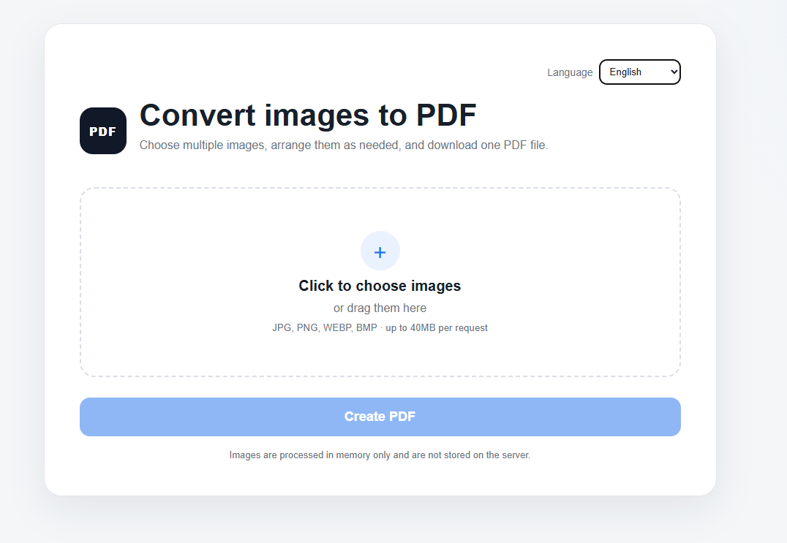
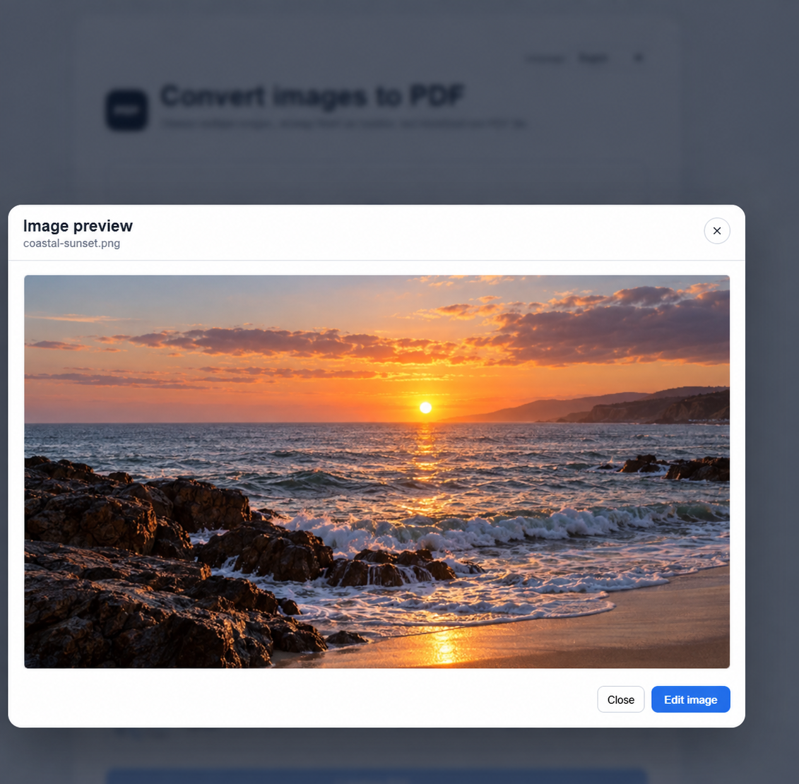

# Image2PDF

**English** | [עברית](README.he.md)

Image2PDF is a lightweight Flask application for uploading, arranging, editing,
and converting multiple images into a single PDF. It can run as a web service,
inside Docker, or as a native desktop executable.

The interface is available in English and Hebrew and automatically switches
between left-to-right and right-to-left layouts.

## Screenshots

### Upload and page arrangement

| Upload screen | Image list and page controls |
| --- | --- |
|  |  |

### Preview and editing

| Full-size preview | Image editor |
| --- | --- |
|  |  |

## Features

- Upload multiple images using the file picker or drag and drop.
- Supports JPG, JPEG, PNG, WEBP, and BMP files.
- Preview every image before creating the PDF.
- Reorder pages with the arrow controls or reverse the complete page order.
- Remove individual images or clear the entire list.
- Hover over the enlarge button to see a larger side preview.
- Open an image in a full-size preview modal.
- Move directly from the preview modal into editing mode.
- Edit brightness, contrast, saturation, and hue.
- Convert an image to black and white.
- Rotate with a degree slider or the 90-degree shortcut buttons.
- Select and crop an area directly on the image.
- Save edited images back into the upload list before PDF generation.
- English and Hebrew language selector with a remembered preference.
- Localized server validation messages.
- In-memory image and PDF processing; uploaded files are not stored on disk.
- A 40 MB total request limit.
- Native executable builds for Windows, macOS, and Linux.
- Docker support for web deployment.

## Download Ready-to-Run Builds

Every version tag creates a GitHub Release with direct-download builds for all
supported desktop systems:

- [Download for Windows](../../releases/latest/download/Image2PDF-Windows.exe)
- [Download for macOS](../../releases/latest/download/Image2PDF-macOS)
- [Download for Linux](../../releases/latest/download/Image2PDF-Linux)

Each executable has a matching `.sha256` checksum and a platform-specific
third-party license report on the [latest release page](../../releases/latest).

The executables are currently unsigned. Windows SmartScreen and macOS
Gatekeeper may display a warning until platform code signing is configured.
On macOS and Linux, make the downloaded file executable before launching it:

```bash
chmod +x Image2PDF-macOS   # macOS
chmod +x Image2PDF-Linux   # Linux
```

## Requirements

- Python 3.10 or newer is recommended
- A modern browser with Canvas and `DataTransfer` support

Install the application dependencies with:

```bash
python -m pip install -r requirements.txt
```

## Run Locally

### Windows PowerShell

```powershell
py -m venv .venv
.\.venv\Scripts\Activate.ps1
python -m pip install -r requirements.txt
python app.py
```

### macOS and Linux

```bash
python3 -m venv .venv
source .venv/bin/activate
python -m pip install -r requirements.txt
python app.py
```

Open the application at:

```text
http://localhost:5000
```

The development server listens on `127.0.0.1` by default. Optional environment
variables are `HOST`, `PORT`, and `FLASK_DEBUG`. The Flask development server
should not be exposed directly in production.

## Run with uv

```bash
uv venv
uv pip install -r requirements.txt
uv run python app.py
```

## Create a Native Executable

Install both the runtime and build dependencies:

```bash
python -m pip install -r requirements.txt -r requirements-build.txt
```

Build the executable for the current operating system:

```bash
python create.py exe
```

The generated file is placed in `dist/`:

| Operating system | Output |
| --- | --- |
| Windows | `dist/Image2PDF.exe` |
| macOS | `dist/Image2PDF` |
| Linux | `dist/Image2PDF` |

When the packaged application starts, it launches a local server on an
available port and opens the default browser automatically. Close its terminal
window or press `Ctrl+C` to stop it.

PyInstaller creates a native build for the operating system on which it runs;
it does not create all platform variants from one machine. Run the same build
command on every target OS, or use the included GitHub Actions workflow to
produce all platform variants in a single build run.

## Multi-Platform GitHub Builds

The workflow at `.github/workflows/build-desktop.yml` starts three native build
jobs in parallel. A single workflow run produces:

- `Image2PDF-Native-Windows`, containing `Image2PDF-Windows.exe`
- `Image2PDF-Native-macOS`, containing the macOS `Image2PDF-macOS` executable
- `Image2PDF-Native-Linux`, containing the Linux `Image2PDF-Linux` executable
- `Image2PDF-All-Platforms`, containing all three platform builds together

This is the multi-platform build option: each executable is compiled on a
runner that matches its target operating system, and the final job collects all
results into one downloadable build artifact.

The workflow runs in either of these cases:

- Manually through the GitHub Actions interface.
- Automatically when a Git tag beginning with `v` is pushed, such as `v1.0.0`.
  Tag builds also create a GitHub Release and attach the executables, checksums,
  project license, and generated third-party license reports.

To start a complete build from the GitHub CLI, run:

```bash
gh workflow run build-desktop.yml
```

## Docker

Build and run the container:

```bash
docker build -t image2pdf .
docker run --rm -p 5000:5000 image2pdf
```

Then open `http://localhost:5000`.

The Docker image uses Gunicorn rather than Flask's development server.

## How Image Editing Works

Editing takes place in the browser using Canvas. The selected adjustments and
crop region are applied when **Save changes** is pressed. The resulting image
replaces that item in the current upload list and is then sent to the server in
the correct page position when the PDF is created.

Edited images are exported as high-quality JPEG files. Transparent areas and
empty corners introduced by rotation are placed on a white background.

## Languages

The language selector supports:

- English (`en`, left-to-right)
- Hebrew (`he`, right-to-left)

The selected language is stored in the browser. The hidden form language value
also ensures that server-side validation errors are returned in the active
language.

## Project Structure

```text
image-to-pdf-saas/
├── .github/
│   ├── ISSUE_TEMPLATE/
│   └── workflows/
│       ├── build-desktop.yml
│       └── tests.yml
├── docs/
│   └── images/
├── scripts/
│   └── prepare_release.py
├── static/
│   ├── app.js
│   └── style.css
├── templates/
│   └── index.html
├── tests/
│   └── test_app.py
├── .dockerignore
├── .gitignore
├── CONTRIBUTING.md
├── CHANGELOG.md
├── app.py
├── create.py
├── Dockerfile
├── Image2PDF.spec
├── LICENSE
├── README.he.md
├── README.md
├── requirements-build.txt
├── requirements.txt
└── THIRD_PARTY_NOTICES.md
```

## Main Components

- `app.py` — Flask routes, image validation, PDF generation, localization of
  server errors, and packaged desktop startup.
- `static/app.js` — upload management, ordering, previews, localization, and
  browser-based image editing.
- `static/style.css` — responsive layout, modal, editor, RTL, and LTR styles.
- `templates/index.html` — application interface and editing controls.
- `create.py` — cross-platform build command.
- `Image2PDF.spec` — PyInstaller configuration, including static assets and
  templates.
- `scripts/prepare_release.py` — release file naming, checksums, and collection
  of license texts from the exact packages installed on each build runner.
- `tests/test_app.py` — HTTP, localization, validation, and PDF generation tests.
- `.github/workflows/build-desktop.yml` — native builds for all three supported
  desktop operating systems and publication of tagged GitHub Releases.
- `.github/workflows/tests.yml` — test and syntax checks across supported Python
  versions.

## Privacy and Storage

Uploaded files are processed in memory and are not intentionally written to the
server's filesystem. Browser-side edits remain local until the PDF form is
submitted. The generated PDF is returned directly as a download.

## Contributing

Contributions are welcome. Read [CONTRIBUTING.md](CONTRIBUTING.md) before
opening a pull request. Please keep changes focused and include relevant tests
and documentation updates.

## License

Image2PDF is available under the [MIT License](LICENSE). It may be used,
modified, redistributed, sublicensed, and used commercially as long as the MIT
copyright and permission notice is retained.

Dependencies remain under their respective licenses. See
[THIRD_PARTY_NOTICES.md](THIRD_PARTY_NOTICES.md). Tagged executable releases
also include license reports generated from the exact dependencies installed
for each operating system.

## Production Considerations

Before operating this project as a public SaaS product, consider adding:

- Authentication and authorization
- Rate limiting and request quotas
- Malware scanning
- More restrictive upload validation
- Background jobs for large conversions
- Monitoring, structured logging, and metrics
- HTTPS through a reverse proxy or managed platform
- Temporary or object storage if persistent files are required
- Broader browser automation and end-to-end test coverage
